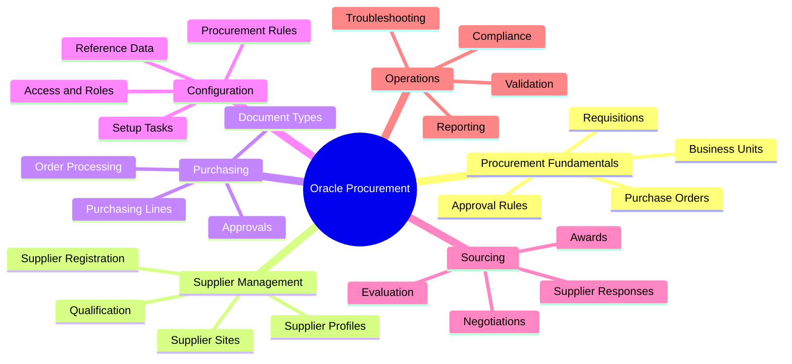
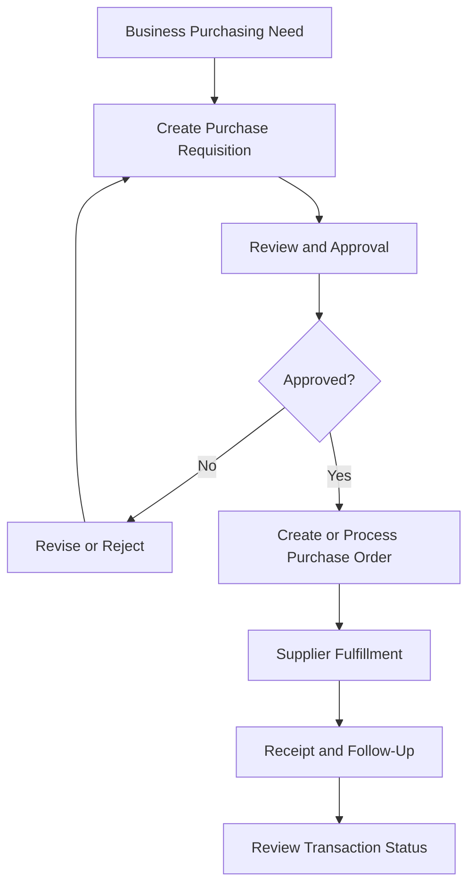
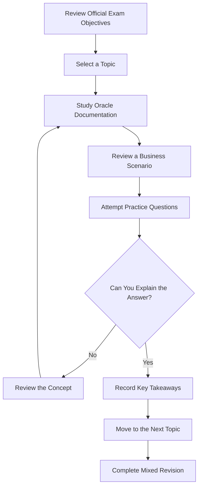

 Oracle 1Z0-1065-26: Fusion Cloud Procurement 2026 Implementation Professional

Preparing for the Oracle Fusion Cloud Procurement 2026 Implementation Professional (1Z0-1065-26)** exam? This repository brings together useful study guidance, procurement concepts, implementation topics, and practice resources to help you organize your preparation.

Whether you're learning Oracle Procurement for the first time or reviewing your existing knowledge, this guide can help you structure your studies and identify areas that need more attention.

Explore additional exam preparation resources: [CertsGate — Oracle 1Z0-1065-26](https://certsgate.com/exams/oracle/1z0-1065-26)

> Important:Check Oracle's official learning resources for the latest exam objectives, requirements, and certification information.

---

 Table of Contents

- [Exam Overview](#exam-overview)
- [Who Should Use This Guide?](#who-should-use-this-guide)
- [Key Study Areas](#key-study-areas)
- [Procurement Process Mind Map](#procurement-process-mind-map)
- [Conceptual Procurement Workflow](#conceptual-procurement-workflow)
- [Exam Preparation Workflow](#exam-preparation-workflow)
- [Four-Week Study Roadmap](#four-week-study-roadmap)
- [Hands-On Practice Checklist](#hands-on-practice-checklist)
- [Practice Questions](#practice-questions)
- [Common Preparation Mistakes](#common-preparation-mistakes)
- [Frequently Asked Questions](#frequently-asked-questions)
- [Official Learning Resources](#official-learning-resources)
- [About CertsGate](#about-certsgate)
- [Disclaimer](#disclaimer)

---

Exam Overview

The 1Z0-1065-26 exam is associated with the Oracle Fusion Cloud Procurement 2026 Implementation Professional certification.

Oracle Fusion Cloud Procurement supports purchasing and supplier-related business processes. Implementation work involves understanding business requirements, configuring relevant features, validating purchasing workflows, and ensuring that procurement activities follow organizational policies.

| Detail | Information |
|---|---|
| Exam code | 1Z0-1065-26 |
| Exam name | Oracle Fusion Cloud Procurement 2026 Implementation Professional |
| Provider | Oracle |
| Product family | Oracle Fusion Cloud Applications |
| Main focus | Procurement implementation and configuration |
| Preparation approach | Official learning resources, configuration scenarios, and practice |

For current information about exam duration, question format, passing requirements, and scheduling, consult Oracle's official certification resources.

---

 Who Should Use This Guide?

This repository may be useful for:

- Oracle Fusion Cloud Procurement consultants.
- Procurement and purchasing professionals.
- Supply chain management specialists.
- Functional implementation consultants.
- Business analysts working with purchasing workflows.
- Certification candidates who want a structured study plan.

Familiarity with procurement processes, supplier management, purchase requisitions, purchase orders, and enterprise applications can be helpful.

If you're new to Oracle Procurement, begin with the business process before moving into detailed configuration scenarios.

---

 Key Study Areas

Use the following areas as a study framework. Confirm the exact exam scope using Oracle's current learning path.

 1. Procurement Fundamentals

Understand how procurement supports an organization's purchasing activities.

- Procurement business processes.
- Purchasing policies and requirements.
- Requisitions and purchase orders.
- Procurement document lifecycles.
- Procurement business units.
- Approval and control concepts.

Study goal: Understand how a purchasing requirement moves through the procurement process.

 2. Supplier Management

Review how supplier information and relationships support purchasing.

- Supplier registration and qualification concepts.
- Supplier profiles and information.
- Supplier sites and purchasing relationships.
- Supplier qualification questions.
- Supplier evaluation and approval processes.
- Supplier-related configuration.

Study goal: Understand how supplier information is maintained and evaluated within procurement workflows.

3. Purchasing and Purchase Orders

Focus on the purchasing process and its configuration.

- Purchase requisitions.
- Purchase orders.
- Purchasing document types.
- Document approvals.
- Purchasing line and document concepts.
- Procurement controls and validation.
- Order processing and document status.

Study goal: Explain how purchasing documents are created, approved, and managed according to business requirements.

 4. Procurement Configuration

Learn how implementation choices support different purchasing requirements.

- Setup and configuration concepts.
- Procurement business functions.
- Document styles and purchasing rules.
- Procurement agents and access.
- Reference data.
- Approval configuration.
- Configuration dependencies.

Study goal: Understand which configuration area to investigate when a procurement requirement cannot be met by the default setup.

 5. Sourcing and Supplier Negotiations

Review how organizations manage supplier competition and purchasing decisions.

- Sourcing processes.
- Negotiation documents.
- Supplier participation.
- Supplier responses and evaluation.
- Award and purchasing considerations.
- Relationships between sourcing and purchasing.

Study goal: Understand the purpose of sourcing and how it supports supplier selection.

6. Procurement Contracts and Controls

Study contract-related concepts and purchasing controls that may apply to the exam objectives.

- Procurement contract concepts.
- Purchasing terms and conditions.
- Contract compliance.
- Document controls.
- Approval requirements.
- Procurement policy enforcement.

Study goal:Understand how procurement controls help maintain consistent and compliant purchasing practices.
 7. Reporting and Troubleshooting

Develop a methodical approach to analyzing procurement issues.

- Transaction status and validation.
- Approval workflow troubleshooting.
- Supplier and purchasing data checks.
- Procurement reporting concepts.
- Configuration-related issues.
- Root-cause analysis.

Study goal: Learn to investigate problems by reviewing the transaction, configuration, and business requirement.

---

 Procurement Process Mind Map

Use this map to organize your revision notes and connect procurement features to real business scenarios.

---

 Conceptual Procurement Workflow

The following diagram illustrates a simplified procurement process. Actual workflows depend on an organization's configuration and business requirements.

### Key concepts

- Requisition: Communicates an internal purchasing requirement.
- Approval: Applies organizational review and authorization rules.
- Purchase order: Communicates approved purchasing details to the supplier.
- Supplier management:Maintains information needed for procurement transactions.
- Validation: Helps identify issues that prevent a transaction from progressing.

This diagram is a general learning example rather than a complete Oracle configuration specification.

---

Exam Preparation Workflow

Use this approach to make your study sessions more productive.

Don't focus only on remembering definitions. Try to explain why a configuration or process fits a specific purchasing requirement.

---

Four-Week Study Roadmap

This is a suggested timetable, not an official Oracle study schedule. Adapt it to your experience and available study time.

| Week | Main focus | Suggested activities |
|---|---|---|
| Week 1 | Procurement fundamentals | Review purchasing processes, requisitions, purchase orders, and business units |
| Week 2 | Supplier management | Study supplier profiles, registration, qualification, and supplier-related configuration |
| Week 3 | Purchasing and configuration | Review document controls, approvals, sourcing, and relevant contract concepts |
| Week 4 | Troubleshooting and revision | Practice scenarios, review weak areas, and revisit the official exam objectives |

 Suggested daily routine

1. Select a topic from the official learning path.
2. Read the relevant Oracle documentation.
3. Summarize the process in your own words.
4. Review a practical business scenario.
5. Answer practice questions.
6. Record mistakes and revisit unclear concepts.

---

 Hands-On Practice Checklist

Where you have access to an authorized Oracle Fusion Cloud training environment, use practical exercises to strengthen your understanding.

- [ ] Review procurement business units and setup concepts.
- [ ] Explore supplier profiles and supplier information.
- [ ] Study supplier registration and qualification workflows.
- [ ] Trace a purchase requisition through its approval process.
- [ ] Review purchase order creation and document status.
- [ ] Understand purchasing document controls and validation.
- [ ] Explore procurement agent responsibilities and access.
- [ ] Review sourcing and supplier negotiation concepts.
- [ ] Study procurement contract concepts where applicable.
- [ ] Investigate common approval and transaction issues.
- [ ] Document the configuration choices required by a business scenario.

Use only authorized environments. Avoid making changes to production systems without appropriate permission.

---

 Practice Questions

Practice questions can help you identify gaps in your understanding and become more comfortable with implementation scenarios.

For each question:

1. Identify the business requirement.
2. Determine which procurement process is involved.
3. Consider the relevant configuration and approvals.
4. Select the most appropriate approach.
5. Explain why it meets the requirement.
6. Review the related Oracle documentation if needed.

For additional exam preparation resources, visit [CertsGate — Oracle 1Z0-1065-26](https://certsgate.com/exams/oracle/1z0-1065-26).

Illustrative practice question

Scenario: A company wants to evaluate prospective suppliers before allowing them to participate in a particular procurement process.

Which capability should the implementation consultant investigate?

A. Supplier qualification  
B. Network security groups  
C. Database backup retention  
D. Compute instance autoscaling  

Answer: A. Supplier qualification.

Explanation: Supplier qualification can support the assessment of suppliers against defined requirements. The precise setup depends on the organization's process and Oracle configuration.

*This is an original illustrative learning question, not an official Oracle exam question.*

---

 Common Preparation Mistakes

Avoid these common mistakes:

- Memorizing terminology without understanding the purchasing lifecycle.
- Confusing requisitions with purchase orders.
- Ignoring supplier management and qualification concepts.
- Overlooking approval rules and transaction status.
- Studying configuration without connecting it to business requirements.
- Ignoring sourcing and procurement controls where they are in scope.
- Using outdated materials without checking Oracle's current learning path.
- Treating third-party practice questions as official exam content.

Focus on understanding how procurement features work together and how configuration supports business needs.

---

 Frequently Asked Questions

 What is the 1Z0-1065-26 exam?

It is the Oracle Fusion Cloud Procurement 2026 Implementation Professional exam.

What should I study?

Start with Oracle's official learning path. Review procurement fundamentals, supplier management, purchasing, configuration, sourcing, and related operational concepts as applicable to the published exam objectives.

 Is practical experience useful?

Yes. Working through procurement scenarios can help you understand configuration choices and how purchasing transactions move through a business process.

 How long should I prepare?

The required time depends on your procurement experience and familiarity with Oracle Fusion Cloud. The four-week plan in this repository is a suggested framework, not an official requirement.

 Where can I find additional preparation resources?

Use Oracle's official learning materials and explore [CertsGate's 1Z0-1065-26 page](https://certsgate.com/exams/oracle/1z0-1065-26).

 Does this guide guarantee a passing result?

No. This guide supports learning and revision but cannot guarantee an exam result.

---

Official Learning Resources

Use official Oracle resources to verify exam details and understand the product's current functionality.

- [Oracle Education and Certification](https://education.oracle.com/)
- [Oracle MyLearn](https://mylearn.oracle.com/)
- [Oracle Cloud Applications Documentation](https://docs.oracle.com/en/cloud/saas/)
- [Oracle Help Center](https://docs.oracle.com/)

Check the current exam listing for the applicable version, objectives, exam format, and registration requirements.

---

 About CertsGate

[CertsGate](https://certsgate.com/) offers IT certification preparation resources for learners exploring professional technology certifications.

For this exam, visit the dedicated page:

[Oracle Fusion Cloud Procurement 2026 Implementation Professional — 1Z0-1065-26](https://certsgate.com/exams/oracle/1z0-1065-26)

Use supplementary preparation resources alongside official documentation, practical exercises, and regular revision.
